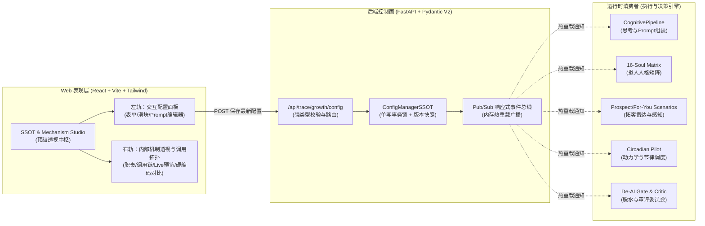
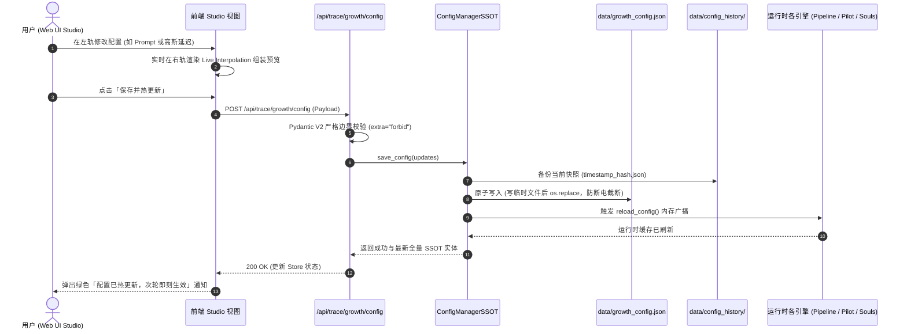

# X-Operator 全量 SSOT 配置化、Prompt 模块化与机制透视中枢架构设计文档

**文档编号**：`PLAN-20261018-X-OP-SSOT-STUDIO-DESIGN`  
**编制时间**：2026-10-18  
**设计目标**：彻底根治 x-operator 内部硬编码问题，将人设、提示词、16-Soul人格、拓客门禁、拟人动力学与认知审评全部收敛至单写 SSOT；在 Web 端打造顶级「SSOT 配置与机制透视中枢（Mechanism Studio）」，支持动态热编辑秒级生效，同屏深度透视内部运行机制与执行拓扑。  
**架构状态**：`APPROVED` (经过 3 轮结构化设计呈批，用户审核确认)

---

## 一、架构背景与硬编码痛点深度排查

在当前 `/home/lichao/tools/x-operator` 系统中，伴随着业务快速迭代，存在多处硬编码与表现层脱节的严重痛点：
1. **Prompt 散落与硬编码**：
   - `x_operator/cognition/pipeline.py` 中写死了数百行三引号系统提示词模板（`identity_prompt_snippet`、`replies_context`、`context_guidance` 等）。
   - 运营者若想调整博主交流口吻、起号人设或场景搭话逻辑，必须深入修改 Python 代码，无法实现轻量化运维。
2. **前端与后端数据割裂（Mock 数据假象）**：
   - 前端驾驶舱 `StrategyAndPromptsCard.tsx` 中写死了搜索策略词数组（`prospectQueries`）与 16 个人格定义及 Prompt（`soulQuadrants`）。
   - 前端展示的数据完全独立于后端真实运行的 `data/growth_config.json` 与 `SOUL_CATALOG`，用户在界面上看到的仅是“宣传海报”，既不能真实修改，也无法获知实际生效的参数。
3. **黑盒化严重，缺乏内部机制透视**：
   - 运营与开发者无法直观获知：“某项提示词或粉丝门禁究竟在推特操作流水线的哪个阶段生效？”、“内部调用了哪个类、哪个函数？”、“它解决了什么风控或业务问题？”。
4. **缺乏原子单写与热生效广播**：
   - 配置修改后需要手动重启守护进程，缺乏进程内响应式刷新机制；缺少版本快照归档与一键安全回滚机制。

---

## 二、架构范围与治理边界（Owns / Does NOT own）

### 1. 明确 Owns（本次架构升级必须建设的内容）
1. **SSOT 领域模型与契约（Domain Contracts）**：
   - 彻底将散落在各模块的配置解耦并收敛为 6 大高内聚子领域契约（Pydantic V2，`extra="forbid"`，强类型校验）。
   - 建立单写事务锁与版本备份机制（`data/growth_config.json` + `data/config_history/`），支持编辑变更、Diff 对比与一键重置默认。
2. **进程内响应式热重载广播（Reactive Hot-Reload Observer）**：
   - 建立内存事件总线 / 订阅者机制：当 Web 保存配置后，后端广播配置变更事件，直接热更新 `CognitivePipeline`、`Pilot` 调度器、`CriticCommittee`、`LayaRouter` 的内部运行时缓存，**实现零重启秒级热生效**。
3. **Web 端顶级「SSOT 与机制透视中枢」（SSOT & Mechanism Studio）**：
   - 在前端提供独立顶级视图 `Studio`（并在现有驾驶舱保留快捷入口直达）。
   - 落地 6 大板块导航：
     - `① 身份人设与防矛盾基石 (Identity)`
     - `② 认知提示词流水线 (Prompt Pipeline)`
     - `③ 16-Soul 拟人人格矩阵 (Souls Matrix)`
     - `④ 拓客雷达与受众立体门禁 (Prospecting Radar)`
     - `⑤ 拟人动力学与风控熔断 (Circadian & Anti-Detection)`
     - `⑥ 模型提供商与脱水门禁 (Cognition & De-AI)`
   - 落地 **2026 Bento-grid 双轨卡片布局**：
     - **左轨（交互操作区）**：结构化表单、高亮多行编辑器、标签输入器、高斯参数平滑滑块、单板块即时保存与一键重置。
     - **右轨（机制透视与架构说明区）**：
       - **「它在内部做什么」**：清晰解释该板块在整体系统中的职责定位与防范的业务/平台风险。
       - **「内部调用链与生效阶段」**：标明在五相认知循环（Perceive -> Think -> Gate -> Act -> Reflect）中的精确执行节点，由哪个 Python 类与函数消费。
       - **「实时装配流向（Live Interpolation Preview）」**：所见即所得展示当前配置在实际调用 LLM 时拼装出的完整 Prompt 真实文本与参数计算结果。
       - **「解决的硬编码痛点」**：明确对比老代码写死的值与新架构 SSOT 的解耦关系。

### 2. 严格声明 Does NOT own（坚决不触碰的负向边界，AP-01）
1. **不修改底层 Playwright 驱动核心与浏览器内核参数**：
   - 不改变 `/x_operator/browser/` 中的拟人贝塞尔曲线算法、Stealth 注入脚本或 CDP 握手协议本身；仅提供动力学参数（延迟高斯均值/工歇节律）的 SSOT 配置化，严禁越权侵入驱动核心。
2. **不重构或改动现有主数据库 schema 与评论表结构**：
   - 不变动 SQLite `comments`、`posts`、`crm_interactions`、`traces` 等已有业务表结构与持久化方式。
3. **不触碰 LCA 框架内核或宿主机运维资产**：
   - 本任务完全自治于 `/home/lichao/tools/x-operator` 独立系统内部，严格遵守仓库专属性原则，严禁在 LCA 框架内部提交任何 x-operator 的特定业务逻辑或脚本。

### 3. 爆炸半径自治等级（Autopilot Ladder，AP-05）
* **评定等级**：**`DRAFT`（需要结构化设计审批与自动化门禁验证）**
* **理由**：本次变更是针对现有系统硬编码的顶级重构，重塑了认知层、调度层与前端的 SSOT 协议与表现层，必须经受严密的设计评审、契约测试与端到端无死角验证。

---

## 三、核心组件架构与 6 大板块领域模型

### 6 大核心板块领域模型与机制透视规范

| 板块编号与名称 | SSOT 包含的核心字段 | 内部在哪个类/代码位置消费 | 内部运行机制与解决的硬编码痛点 |
|---|---|---|---|
| **Plate 1: 身份人设与防矛盾基石** `(Identity SSOT)` | `handle`, `display_name`, `is_blue_verified`, `bio_summary`, `persona_prompt` | `x_operator/cognition/pipeline.py` (`identity_prompt_snippet`) 与 `de_ai_skills_gate.py` | **【机制】**：注入全局 System Prompt 第一段。模型生成候选回复后，强制进行蓝V身份自洽性扫描。 **【硬编码痛点】**：原先代码中写死了博主昵称与蓝V身份描述，且无法自定义防矛盾规则；配置化后支持动态更新人设，杜绝白号幻觉。 |
| **Plate 2: 认知提示词流水线** `(Prompt Pipeline SSOT)` | `system_prompt_base`, `mutual_follow_hook_prompt`, `for_you_hook_prompt`, `context_understanding_prompt` | `x_operator/cognition/pipeline.py` (`system_prompt` 与 `user_prompt` 组装器) | **【机制】**：位于五相循环的 **Think（思考）** 阶段。根据当前是互关拓客还是推荐流冲浪，动态拼接对应的 Hook 规则与语境情绪感知引导。 **【硬编码痛点】**：彻底消除了代码中数百行三引号 Python 提示词魔数，Prompt 调整后秒级生效，无需重启进程。 |
| **Plate 3: 16-Soul 拟人人格矩阵** `(Souls Matrix SSOT)` | 4大象限 16 种 Soul 的 `enabled` 开关、`custom_prompt` 覆盖、`tone_keywords`、`banned_vibes`、`priority` | `x_operator/curator/souls.py` 与 `pipeline.py:_process_soul` | **【机制】**：位于 **Think（并发推演）** 阶段。由 `LayaRouter` 语义识别推文后挑出最匹配的 5 个 Soul 并行推演 5 种不同视角人格的候选短句。 **【硬编码痛点】**：前端之前硬编码了静态的 16-Soul 卡片，无法编辑；重构后每一个 Soul 的 Prompt 均可独立微调或一键恢复默认。 |
| **Plate 4: 拓客雷达与受众立体门禁** `(Prospecting Radar SSOT)` | `search_queries`, `strict_mutual_tags`, `min_followers`, `sweet_spot_max`, `max_followers`, `require_blue_verified`, `auto_follow` | `x_operator/scheduler/scenarios.py` (`run_prospect_search` 过滤漏斗) | **【机制】**：位于 **Perceive（感知）** 阶段。驱动 Playwright 搜索 Twitter 互关生态词，提取推文作者粉丝量与蓝V标识，执行四层门禁漏斗拦截水军号。 **【硬编码痛点】**：消除了写死在前端和 Python 列表里的搜索词，运营者可随推特当下流行热梗随时修改检索词与粉丝阈值。 |
| **Plate 5: 拟人动力学与风控熔断** `(Circadian & Anti-Detection)` | `comment_delay_mean/min/max/std`, `coffee_break_work`, `coffee_break_duration`, `random_skip_prob`, `silent_cooling` | `x_operator/scheduler/pilot.py` 与 `scenarios.py` 动力学延迟器 | **【机制】**：位于 **Act（行动）** 阶段。在发表评论前，基于高斯截断分布随机睡眠，并在工作 75-100 分钟后强制进入咖啡工歇；若触发风控自动进入 72h 静默降温。 **【硬编码痛点】**：延迟魔数从代码中彻底解耦，前端提供直观的双滑块与高斯曲线示意，风控状态一键感知。 |
| **Plate 6: 去 AI 脱水与审评门禁** `(Cognition & De-AI Gates)` | `llm_provider` (unisound/qwen/grok), `critic_min_score`, `slop_gate_enabled`, `mismatch_gate_enabled` | `x_operator/cognition/critic_committee.py` 与 `de_ai_skills_gate.py` | **【机制】**：位于 **Gate（审评闸门）** 阶段。对 5 组 Soul 候选文本执行 10 大去 AI 痕迹清洗与多维度综合打分，低于阈值直接打回或丢弃，确保 100% 像真人推友。 **【硬编码痛点】**：消除了模型提供商与审评阈值的写死配置，支持在 Web 端一键切换底层大模型与调节严苛度。 |

---

## 四、响应式数据流与单写持久化

1. **原子持久化**：采用 `NamedTemporaryFile` + `os.replace`，杜绝并发写入冲突或断电导致的 JSON 文件半损坏。
2. **版本快照归档**：在 `data/config_history/` 自动以 `YYYYMMDD_HHMMSS_<md5>.json` 保存历史快照（最多保留 50 份），支持未来一键回滚。
3. **零重启内存广播**：`CognitivePipeline`、`Pilot` 调度器、`CriticCommittee` 在下次推理或定时器心跳时直接命中最新内存状态，彻底告别重启等待。

---

## 五、自动化测试不变量断言矩阵（Invariants in Tests，AP-02）

| 不变量编号 | 核心断言内容 | 测试验证方式 (Pytest / TS) |
|---|---|---|
| **INV-SSOT-01 (单写 SSOT 铁律)** | 系统内所有配置读写必须严格经由 `load_growth_config` 与 `save_growth_config` / `ConfigManagerSSOT`，严禁业务代码直接读写底层 JSON 或引入第二套配置字典。 | 静态 AST/grep 扫描与单测拦截，断言除 SSOT 模块外 0 处直接写入底层文件。 |
| **INV-SSOT-02 (数值与逻辑边界铁律)** | 所有字段严格遵循物理与业务区间门禁： ① `comment_delay_min <= comment_delay_mean <= comment_delay_max` ② `min_followers <= sweet_spot_max <= max_followers` ③ `critic_min_score ∈ [60.0, 95.0]` ④ 传入非法越界参数必须被拦截或安全收敛，绝不污染持久化层。 | 编写参数越界单测，验证边界收敛与类型防御 100% 生效。 |
| **INV-SSOT-03 (零重启热生效铁律)** | 调用 API 更新 `prompts` 或 `account_profile` 后，无需重启服务，`CognitivePipeline` 在下一次执行候选推演时必须立即消费新配置，生成的真实 System Prompt 必包含新修改的内容。 | 编写热重载端到端单测：修改系统提示词 -> 立即调用 `CognitivePipeline.synthesize_comment` -> 断言返回的 `system_prompt` 实时体现新词。 |
| **INV-SSOT-04 (16-Soul 独立覆盖铁律)** | 在 `souls_config` 中对指定 Soul 配置 `custom_prompt` 或设为 `enabled=False`： ① `get_effective_soul_catalog()` 中该 Soul 的 Prompt 成功变为自定义值； ② `get_active_soul_ids()` 中禁用 Soul 被精确剔除； ③ 原始 `SOUL_CATALOG` 静态底座不受任何原地破坏性污染。 | 编写 Soul 动态覆盖与隔离单测，验证生效与幂等性。 |
| **INV-SSOT-05 (历史快照自愈铁律)** | 每次调用配置更新，必须在 `data/config_history/` 中成功产生不可变快照文件，且快照内容与修改前的数据完全一致，支持读取历史进行还原。 | 编写快照生命周期测试，验证快照生成、数量上限轮转与回退还原。 |
| **INV-SSOT-06 (前端零硬编码铁律)** | 前端 `MechanismStudioView` 及其子组件中严禁存在写死的搜索词或 Mock Soul 列表，所有展示数据必须 100% 来源于 `/api/trace/growth/config` 与 `/api/trace/souls`。 | 编写前端单元测试与构建静态检查，验证数据流绑定完整性。 |

---

## 六、实施步骤规划（向 writing-plans 衔接）

1. **TASK-1 (SSOT 契约与单写持久化强化)**：完善 `growth_config.py` 与 `router_trace.py`，支持历史快照与校验。
2. **TASK-2 (后端零重启内存广播与热重载)**：改造 `CognitivePipeline` 与 `Pilot` 调度器，支持实时订阅配置变更。
3. **TASK-3 (16-Soul 动态覆盖与隔离断言)**：打通 `souls.py` 动态覆盖与 Prompt 合成。
4. **TASK-4 (前端 Mechanism Studio 顶级架构与双轨组件落地)**：打造 6 大板块与机制透视卡片。
5. **TASK-5 (驾驶舱子 Tab 与导航无缝对接)**：重构 `StrategyAndPromptsCard` 为 Studio 嵌入视图，彻底删除 Mock 数据。
6. **TASK-6 (全量不变量测试套件与端到端闭环验证)**：落实 INV-SSOT-01 至 INV-SSOT-06 自动化测试。
