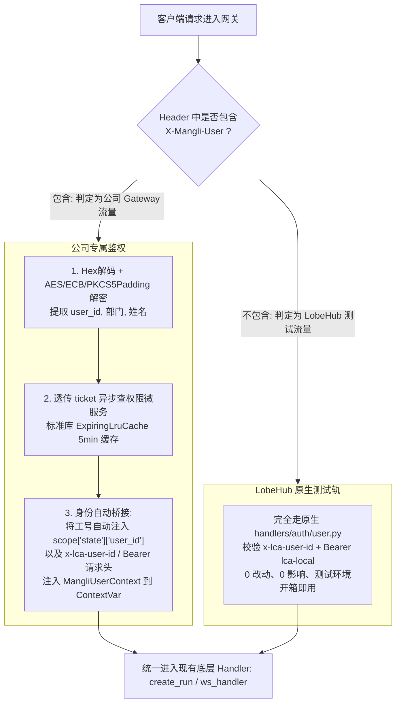

# 企业级应用集成与统一接口封装设计 (Mangli Enterprise Integration Design)

> **设计状态：** Approved (深度审查收敛版：全量吸收 M1~M9 架构与安全防护结论)  
> **设计日期：** 2026-11-16  
> **自治等级：** DRAFT (外围插件 Seam/Provider 范式，严格守护底层核心单向依赖)  
> **宪法约束：** 遵照根目录 `AGENTS.md`（C1 认知闭集、C2 双平面、C4 Reducer单写、C5 能力单调、C6 最小化、C10 执行窄门、C11 事件闭集、C13 信息血统闭合、C14 图与业务隔离）。

---

## 1. 架构定位：原生 URL 全面复用与双轨自适应鉴权

### 1.1 拒绝双套 URL，全面复用既有标准端点
系统**坚决不新建平行冗余的 `/api/v1` URL 副本**。无论是公司前端组、公司 Gateway、Playground 还是既有的 LobeHub 测试端，统一直接复用成熟的原生端点：
- **发起任务**：`POST /runs`（直接复用 `command_endpoints:create_run`，返回 `run_id` 与 `ws_token`）
- **实时全双工流式输出**：`WS /v1/runs/{run_id}/ws?token={ws_token}`（直接复用原生基于 Redis Stream 的 WebSocket 通道，带 30s 双向心跳防 Spring Cloud Gateway 断连）
- **取消任务**：`POST /runs/{id}/cancel`（直接复用 `cancel_run`）
- **人机交互答复**：`POST /runs/{id}/answer`（直接复用 `answer_run`）
- **文件下载**：`GET /files/{attachment_id}`（直接复用 `download_file`）
- **模型枚举**：`GET /v1/models`（直接复用 `list_models`）

**仅增量新增全仓缺失的企业级项目与会话管理领域实体**：
- **`Projects` 领域端点**：`GET /projects`、`POST /projects`、`GET /projects/{id}`、`DELETE /projects/{id}`（由 `ProjectStore` 支撑）；
- **企业会话管理端点**：`GET /projects/{id}/sessions`、`POST /projects/{id}/sessions`，以及个人游离会话 `GET /sessions?unassigned=true`；
- **验证控制台**：`GET /playground`（纯静态 HTML 控制台，挂载在 `lca/plugins/transport/webserver/static/mangli_playground.html`，兼测两套身份与 WebSocket 打字机）。

---

## 2. 自适应双轨鉴权机制 (Smart Adaptive Auth Bridge)

### 2.1 核心设计：智能流量识别与中间件 Seam 挂载 (M4)
根据架构核实，`RouteRegistryProtocol` 仅负责 Route 注册而不管理中间件。为确保所有原生路由（特别是 `POST /runs`）无需逐一修改即可透明获得企业工号，我们在 `lca/plugins/transport/webserver/server/server.py` 中规范声明中间件 Seam：在 `install_trace_middleware(app)` 旁挂载 `install_adaptive_auth_middleware(app)`，并将 `server.py` 如实列入本次任务的 **Owns** 清单。



### 2.2 运作细节与安全性 (M4 & M7)
1. **LobeHub 测试界面零影响**：
   - LobeHub 前端继续发送原生 `x-lca-user-id` 与 `Bearer lca-local`；
   - 中间件检测到无 `X-Mangli-User`，**无条件直接放行（Pass-Through）**，由原有的 `handlers/auth/user.py` 处理；LobeHub 功能 100% 保持现状；
2. **公司 Gateway 流量透明桥接**：
   - 提取 `X-Mangli-User` 完成 AES 解密，提取用户工号；
   - 中间件将该工号无缝桥接赋给底层的 `x-lca-user-id`；
   - 底层复用的 `create_run`、Session 事实流在完全不改动的情况下，自然将本次运行归属于该员工，实现数据隔离与审计；
3. **加解密规范与安全假设 (M7)**：
   - **安全假设**：`AES/ECB` 模式无 MAC/Tag，方案严格建立在“公司 Spring Cloud Gateway 与 LCA 后端部署在受信任内网”的前提下；
   - **密钥对齐**：以 16 字节 Hex 原始密钥（`MANGLI_AES_KEY_HEX`）为主路（`bytes.fromhex(...)`），SHA1PRNG 动态派生为兼容辅路；
   - **Java 静态向量金标准**：单元测试使用真实 Java 原生运行生成的**固定向量三元组（Plaintext, Key, Hex Ciphertext）**进行静态断言，证明与 Java 网关的确定性互通；
4. **纯标准库零依赖缓存 (M8)**：
   - 使用 Python 标准库 `collections.OrderedDict` + `time.monotonic()` 实现 `ExpiringLruCache`（5 分钟 TTL），防止权限接口被高频穿透，全仓不引入 `cachetools` 新依赖。

---

## 3. 多租户 Run 并发去重隔离 (M9)

### 3.1 漏洞根因
原生 `run_dedup_key`（位于 [index.py](file:///h:/Workspace/KLTB/SourceCode/tongbao-ai/layered-cognitive-agent/lca/plugins/transport/webserver/handlers/runs/session/index/index.py#L27-L42)）在计算正在执行的 In-flight Run 指纹时，哈希字段仅包含 `mode`、`principal`（`agent_id`）、`normalized`（`user_text`）和 `attachments`，**完全遗漏了 `user_id`**。  
在企业多用户并发场景下，若员工 A 与员工 B 同时发送相同的问题，员工 B 会被错误合并入员工 A 的 Run 实例并监听其 WebSocket，造成跨租户数据泄露。

### 3.2 治理方案
将 `lca/plugins/transport/webserver/handlers/runs/session/index/index.py` 与 `lca/plugins/transport/webserver/handlers/runs/terminal/registry/commands.py` 纳入修改范围（属于 Transport 插件层）：
1. 修改 `run_dedup_key`，强制将 `user_id` 作为哈希首要维度：
   ```python
   payload = f"{user_id}\0{mode}\0{principal}\0{normalized}\0{attachments}"
   ```
2. 相应更新 `find_inflight_run(..., user_id: str = "")` 和 `commands.py:create_and_dispatch`，确保不同用户的并发请求绝对不会被错误合并。

---

## 4. Projects 领域模型与存储架构

因全仓当前无 Project 概念，在 `lca/infrastructure/persistence/project_store.py` 中实现 `ProjectStore`，严格遵循 LCA 已验证的双后端模式（参考 `UserAssistantStore`）：

### 4.1 数据库 Schema
- **本地/开发（SQLite `~/.lca/lca.sqlite3`）与生产（Postgres `LCA_DATABASE_URL`）**：
```sql
CREATE TABLE IF NOT EXISTS lca_projects (
    project_id    TEXT PRIMARY KEY,
    name          TEXT NOT NULL,
    description   TEXT,
    owner_user_id TEXT NOT NULL,
    dept_id       TEXT,
    created_at    TEXT NOT NULL DEFAULT (datetime('now')),
    updated_at    TEXT NOT NULL DEFAULT (datetime('now'))
);
CREATE TABLE IF NOT EXISTS lca_project_sessions (
    project_id    TEXT NOT NULL REFERENCES lca_projects(project_id) ON DELETE CASCADE,
    session_id    TEXT PRIMARY KEY,
    created_at    TEXT NOT NULL DEFAULT (datetime('now'))
);
CREATE INDEX IF NOT EXISTS idx_lca_projects_owner ON lca_projects(owner_user_id);
CREATE INDEX IF NOT EXISTS idx_lca_project_sessions_proj ON lca_project_sessions(project_id);
```

### 4.2 项目与游离会话隔离规则
1. **项目会话**：创建会话时传入 `project_id`，写入 `lca_project_sessions` 关系表。项目内仅允许创建者及同部门成员访问；
2. **游离会话（个人独立会话）**：创建会话时 `project_id` 为空，不写入关系表。通过 `GET /sessions?unassigned=true` 仅返回当前用户的游离会话；通过 `GET /projects/{project_id}/sessions` 查询指定项目的会话。

---

## 5. 接口规范全景 (全盘复用 + 增量补齐)

| 路径 | 方法 | 说明 | 实现归属 |
|---|---|---|---|
| **`/projects`** | `GET/POST` | 项目列表查询 / 项目创建 | **新增**：读写 `ProjectStore` |
| **`/projects/{id}`** | `GET/DELETE` | 单个项目详情 / 删除项目 | **新增**：读写 `ProjectStore` |
| **`/projects/{id}/sessions`** | `GET/POST` | 项目会话列表查询 / 项目下创建会话 | **新增**：`ProjectStore` 会话关系维护 |
| **`/sessions`** | `GET/POST` | 用户会话列表（`?unassigned=true` 查个人游离会话） / 创建会话 | **新增**：`ProjectStore` 企业会话服务 |
| **`/runs`** | `POST` | 发起提问与任务执行（返回 `run_id` 与 `ws_token`） | **原生复用**：`command_endpoints:create_run` |
| **`/v1/runs/{id}/ws`** | `WS` | WebSocket 实时全双工流式打字机（带 30s 双向心跳防超时） | **原生复用**：`routes_agent_gateway_ws.py` |
| **`/runs/{id}/cancel`**| `POST` | 取消任务运行 | **原生复用**：`cancel_run` |
| **`/runs/{id}/answer`**| `POST` | 人机交互确认 / 回复继续执行 | **原生复用**：`answer_run` |
| **`/files/{attachment_id}`** | `GET` | 下载生成的文件 | **原生复用**：`download_file` |
| **`/v1/models`** | `GET` | 可用模型枚举 | **原生复用**：`list_models` |
| **`/playground`** | `GET` | 离线自包含的单页验证控制台 | **新增静态挂载** |

---

## 6. 工具体系、执行窄门与 MCP 集群 (M5 & M6)

### 6.1 严格符合 LCA `Tool` 协议 (M5)
工具必须实现 [infra.py](file:///h:/Workspace/KLTB/SourceCode/tongbao-ai/layered-cognitive-agent/lca/contracts/protocols/runtime/infra/infra.py#L60-L79) 声明的 `Tool(Protocol)`：
```python
class MangliEnterpriseTool(Tool):
    name: ClassVar[str] = "mangli_workspace_export"
    namespace: ClassVar[str] = "workspace"
    description: ClassVar[str] = "Export text/data content to user workspace file."
    parameters: ClassVar[dict[str, Any]] = {
        "type": "object",
        "properties": {
            "path": {"type": "string", "description": "Relative filename"},
            "content": {"type": "string", "description": "File text content"},
        },
        "required": ["path", "content"],
    }
    is_idempotent: ClassVar[bool] = False
    effect_kind: ClassVar[Literal["ephemeral", "persistent", "stateful_once"]] = "persistent"
    default_timeout_s: ClassVar[int] = 30

    async def execute(self, args: dict[str, Any]) -> Observation:
        ...
```
并通过 `tools_seam.register_factory(name, factory)` 注册，工厂入参为 `bindings: BindingsView`。

### 6.2 执行窄门与租户边界防越权 (M6)
1. **租户参数隔离**：模型的调用参数（`parameters`）中**严禁**包含 `project_id`、`session_id` 或 `user_id`，防止模型幻觉或注入造成跨租户越权访问；租户上下文统一在工厂构造工具实例时从 `bindings: BindingsView` / 运行时上下文静默注入；
2. **遵守 C10/C11 窄门与事件闭集**：工具执行统一交由 `SimpleSafeExecutor` 调度并记录 `ToolStarted` / `ToolInvoked`，工具内部严禁私自发射非白名单的自定义 Journal 事件；
3. **复用原生 `FileStore`**：文件落地调用系统成熟的 `FileStore.put(data=..., name=..., mime_type=..., origin="agent_created")`，返回标准的 `attachment_id`，前端统一通过原生 `/files/{attachment_id}` 接口下载。

### 6.3 外部数据 MCP-First 集群
- OA、Wiki、Jira、企业知识库通过标准 MCP 协议挂载，由 LCA 内置的 `lca/infrastructure/mcp/` 客户端通过 `tools/list` 自动发现，零手写胶水代码；
- 智能问数 Agent 挂载为 MCP Server 或 A2A 协议代理。

---

## 7. 声明式编排与插件元数据规范 (M1, M2, M3)

### 7.1 标准 Bundle 定义 (`bundles/mangli-enterprise.yaml`) (M1)
遵循 [source.py#L243](file:///h:/Workspace/KLTB/SourceCode/tongbao-ai/layered-cognitive-agent/lca/harness/profile/resolve/source.py#L243) 的 `entries:` 结构：
```yaml
entries:
  - id: mangli-enterprise-routes
    name: mangli_enterprise_routes
    $module: lca.plugins.transport.webserver.routes_mangli_projects
    config: {}
  - id: mangli-enterprise-tools
    name: mangli_enterprise_tools
    $module: lca.plugins.tools.mangli_enterprise_tools
    config: {}
```

### 7.2 生产级 Profile 声明 (`profiles/mangli-enterprise.yaml`) (M2)
完整挂载生产级所需的 14 个 bundles（保证 `route_registry` 与 5 阶段认知子图就绪），并在末尾挂载专属 bundle：
```yaml
bundles:
  - bundles/base.yaml
  - bundles/observability-default.yaml
  - bundles/observation-9module.yaml
  - bundles/web-app.yaml
  - bundles/scenario-cordis-creator.yaml
  - bundles/loop_cursor.spine_default.yaml
  - bundles/session-runtime.yaml
  - bundles/event-bus-components.yaml
  - bundles/outer/phase_main.yaml
  - bundles/think/think_subgraph.yaml
  - bundles/act/act_subgraph.yaml
  - bundles/perceive/perceive_subgraph.yaml
  - bundles/reflect/reflect_subgraph.yaml
  - bundles/remember/remember_subgraph.yaml
  - bundles/mangli-enterprise.yaml

patch:
  - id: spine.sink.file
    config:
      boot_path: .lca/spine/boot-spine.jsonl
      runs_root: {from_env: LCA_RUNS_ROOT}
  - id: lca-effect-permission-manifest-default
    disabled: true
```

### 7.3 `@plugin` 完整装饰器契约 (M3)
所有新增插件严格满足 `layer="L1"`、`kind=PluginKind.PROVIDER`、`effects="none"`、`contract=PluginContract(...)`、`ownership=OwnershipDeclaration(...)`，确保通过 `./scripts/lca-ops audit-plugin-shape` 门禁。

---

## 8. 边界划分与 Owns 清单 (AP-01 & M8)

### 8.1 负向边界 (Does NOT own)
严禁触碰任何核心层代码：
- `lca/contracts/`
- `lca/cognition/`
- `lca/runtime/`
- `lca/loop/`
- `lca/framework/`
- `lca_kernel/`
- `vendor/`

### 8.2 正向职责 (Owns)
本次集成仅允许修改或创建以下范围内的文件：
- **鉴权与中间件**：
  - `lca/plugins/transport/webserver/handlers/auth/mangli_auth.py` (新增)
  - `lca/plugins/transport/webserver/server/server.py` (修改：挂载中间件 Seam)
- **多租户去重安全修复**：
  - `lca/plugins/transport/webserver/handlers/runs/session/index/index.py` (修改：加入 user_id)
  - `lca/plugins/transport/webserver/handlers/runs/terminal/registry/commands.py` (修改：透传 user_id)
- **领域持久化与路由**：
  - `lca/infrastructure/persistence/project_store.py` (新增)
  - `lca/plugins/transport/webserver/routes_mangli_projects.py` (新增)
- **工具与静态控制台**：
  - `lca/plugins/tools/mangli_enterprise_tools.py` (新增)
  - `lca/plugins/transport/webserver/static/mangli_playground.html` (新增)
- **编排配置**：
  - `bundles/mangli-enterprise.yaml` (新增)
  - `profiles/mangli-enterprise.yaml` (新增)
- **测试套件**：
  - `tests/plugins/transport/test_mangli_auth.py`
  - `tests/plugins/persistence/test_project_store.py`
  - `tests/plugins/transport/test_routes_mangli_projects.py`
  - `tests/plugins/tools/test_mangli_enterprise_tools.py`
  - `tests/plugins/transport/test_mangli_playground.py`
  - `tests/plugins/transport/test_multitenant_inflight_run_dedup.py`
  - `tests/scenario/test_mangli_enterprise_bundle_invariants.py`

---

## 9. 自动化测试不变量矩阵 (AP-02 & M7)

| 不变量编号 | 守护规则与断言 | 验证用例 |
|---|---|---|
| **INV-01** | Java 原生静态密文向量解密一致性（包含 16 字节 Hex 密钥主路与固定 Java 向量三元组） | `test_java_cross_compatibility_vector` |
| **INV-02** | 权限微服务 5 分钟 TTL 缓存命中与容灾（纯标准库 `ExpiringLruCache`） | `test_permission_cache_ttl_and_error_handling` |
| **INV-03** | 自适应双轨鉴权隔离（无 `X-Mangli-User` 时 LobeHub 100% 原生放行；有 `X-Mangli-User` 时公司解密与桥接） | `test_adaptive_auth_double_track` |
| **INV-04** | 多租户 In-flight Run 并发去重隔离（不同用户的相同提问互不干扰） | `test_multitenant_inflight_run_dedup_isolation` |
| **INV-05** | Projects 持久化 CRUD、游离会话与项目成员权限隔离 | `test_project_isolation_and_unassigned_sessions` |
| **INV-06** | 真实工具契约符合性（继承 `Tool`，声明 `parameters`，返回 `Observation`，沙箱文件写入生成 `FileStore` 凭证） | `test_tool_conforms_to_lca_contract` |
| **INV-07** | Playground 离线自包含（纯原生 CSS，无外网 CDN，`GET /playground` 严格返回 200） | `test_playground_offline_render` |
| **INV-08** | **分支基线零修改铁律**：`git diff --name-only origin/main...HEAD -- lca/contracts lca/cognition lca/runtime lca/loop lca/framework lca_kernel vendor` 退出码必为 0 且输出必为空！ | `test_core_zero_mutation_against_merge_base` |
