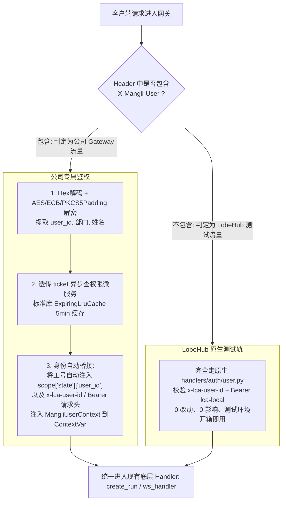

# 企业级应用集成与统一接口封装设计 (Mangli Enterprise Integration Design)

> **设计状态：** Approved (对齐原生 URL 复用与 LobeHub 自适应双轨鉴权)  
> **设计日期：** 2026-11-16  
> **自治等级：** DRAFT (纯外围扩展与声明式编排，零侵入核心)  
> **宪法约束：** 遵照根目录 `AGENTS.md`（C1 认知闭集、C2 双平面、C4 Reducer单写、C5 能力单调、C6 最小化、C10 执行窄门、C13 信息血统闭合、C14 图与业务隔离）。

---

## 1. 架构定位：原生 URL 全面复用与双轨自适应鉴权

### 1.1 拒绝双套 URL，全面复用既有标准端点
系统**坚决不新建平行冗余的 `/api/v1` URL 副本**。无论是公司前端组、公司 Gateway、Playground 还是既有的 LobeHub 测试端，统一直接复用成熟的原生端点：
- **发起任务**：`POST /runs`（直接复用 `command_endpoints:create_run`，返回 `run_id` 与 `ws_token`）
- **实时全双工流式输出**：`WS /v1/runs/{run_id}/ws?token={ws_token}`（直接复用原生基于 Redis Stream 的 WebSocket 通道，带 30s 双向心跳防 Spring Cloud Gateway 断连）
- **取消任务**：`POST /runs/{id}/cancel`（直接复用 `cancel_run`）
- **人机交互答复**：`POST /runs/{id}/answer`（直接复用 `answer_run`）
- **文件下载**：`GET /files/{attachment_id}`（直接复用 `download_file`）
- **模型枚举**：`GET /v1/models`（直接复用 `list_models`）

**仅增量新增全仓缺失的企业级项目与会话管理领域实体**：
- **`Projects` 领域端点**：`GET /projects`、`POST /projects`、`GET /projects/{id}`（由 `ProjectStore` 支撑）；
- **企业会话管理端点**：`GET /projects/{id}/sessions`、`POST /projects/{id}/sessions`，以及个人游离会话 `GET /sessions?unassigned=true`；
- **验证控制台**：`GET /playground`（纯静态 HTML 控制台，兼测两套身份与 WebSocket 打字机）。

---

## 2. 自适应双轨鉴权机制 (Smart Adaptive Auth Bridge)

### 2.1 核心设计：智能流量识别与身份桥接
中间件（`SmartAdaptiveAuthMiddleware`）作为最外层过滤器，自适应识别调用来源：



### 2.2 运作细节与安全性
1. **LobeHub 测试界面零影响**：
   - LobeHub 前端继续发送原生 `x-lca-user-id` 与 `Bearer lca-local`；
   - 中间件检测到无 `X-Mangli-User`，**无条件直接放行（Pass-Through）**，由原有的 `handlers/auth/user.py` 处理；LobeHub 功能 100% 保持现状；
2. **公司 Gateway 流量透明桥接**：
   - 提取 `X-Mangli-User` 完成 AES 解密，提取用户工号；
   - 中间件将该工号无缝桥接赋给底层的 `x-lca-user-id`；
   - 底层复用的 `create_run`、Session 事实流在完全不改动的情况下，自然将本次运行归属于该员工，实现数据隔离与审计；
3. **加解密规范与安全假设**：
   - **安全假设**：`AES/ECB` 模式无 MAC/Tag，方案严格建立在“公司 Spring Cloud Gateway 与 LCA 后端部署在受信任内网”的前提下；
   - **密钥对齐**：以 16 字节 Hex 原始密钥（`MANGLI_AES_KEY_HEX`）为主路，SHA1PRNG 动态派生为兼容辅路；单元测试强制使用由真实 Java 原生运行产出的静态密文向量验证；
4. **零依赖缓存**：
   - 使用 Python 标准库 `collections.OrderedDict` + `time.monotonic()` 实现 `ExpiringLruCache`（5 分钟 TTL），防止权限接口被高频打穿。

---

## 3. Projects 领域模型与存储架构

因全仓当前无 Project 概念，在 `lca/infrastructure/persistence/project_store.py` 中实现 `ProjectStore`，严格遵循 LCA 已验证的双后端模式（参考 `UserAssistantStore`）：

### 3.1 数据库 Schema
- **本地/开发（SQLite `~/.lca/lca.sqlite3`）与生产（Postgres `LCA_DATABASE_URL`）**：
```sql
CREATE TABLE IF NOT EXISTS lca_projects (
    project_id    TEXT PRIMARY KEY,
    name          TEXT NOT NULL,
    description   TEXT,
    owner_user_id TEXT NOT NULL,
    dept_id       TEXT,
    created_at    TEXT NOT NULL DEFAULT (datetime('now')),
    updated_at    TEXT NOT NULL DEFAULT (datetime('now'))
);
CREATE TABLE IF NOT EXISTS lca_project_sessions (
    project_id    TEXT NOT NULL REFERENCES lca_projects(project_id) ON DELETE CASCADE,
    session_id    TEXT PRIMARY KEY,
    created_at    TEXT NOT NULL DEFAULT (datetime('now'))
);
CREATE INDEX IF NOT EXISTS idx_lca_projects_owner ON lca_projects(owner_user_id);
CREATE INDEX IF NOT EXISTS idx_lca_project_sessions_proj ON lca_project_sessions(project_id);
```

### 3.2 项目与游离会话隔离规则
1. **项目会话**：创建会话时传入 `project_id`，写入 `lca_project_sessions` 关系表。项目内仅允许创建者及同部门成员访问；
2. **游离会话（个人独立会话）**：创建会话时 `project_id` 为空，不写入关系表。通过 `GET /sessions?unassigned=true` 仅返回当前用户的游离会话；通过 `GET /projects/{project_id}/sessions` 查询指定项目的会话。

---

## 4. 接口规范全景 (全盘复用 + 增量补齐)

| 路径 | 方法 | 说明 | 实现归属 |
|---|---|---|---|
| **`/projects`** | `GET/POST` | 项目列表查询 / 项目创建 | **新增**：读写 `ProjectStore` |
| **`/projects/{id}`** | `GET/DELETE` | 单个项目详情 / 删除项目 | **新增**：读写 `ProjectStore` |
| **`/projects/{id}/sessions`** | `GET/POST` | 项目会话列表查询 / 项目下创建会话 | **新增**：`ProjectStore` 会话关系维护 |
| **`/sessions`** | `GET/POST` | 用户会话列表（`?unassigned=true` 查个人游离会话） / 创建会话 | **新增**：`ProjectStore` 企业会话服务 |
| **`/runs`** | `POST` | 发起提问与任务执行（返回 `run_id` 与 `ws_token`） | **原生复用**：`command_endpoints:create_run` |
| **`/v1/runs/{id}/ws`** | `WS` | WebSocket 实时全双工流式打字机（带 30s 双向心跳防超时） | **原生复用**：`routes_agent_gateway_ws.py` |
| **`/runs/{id}/cancel`**| `POST` | 取消任务运行 | **原生复用**：`cancel_run` |
| **`/runs/{id}/answer`**| `POST` | 人机交互确认 / 回复继续执行 | **原生复用**：`answer_run` |
| **`/files/{attachment_id}`** | `GET` | 下载生成的文件 | **原生复用**：`download_file` |
| **`/v1/models`** | `GET` | 可用模型枚举 | **原生复用**：`list_models` |
| **`/playground`** | `GET` | 离线自包含的单页验证控制台 | **新增静态挂载** |

---

## 5. 外部数据体系：MCP-First 集群

1. **企业系统统一走 MCP (Model Context Protocol)**：
   - OA、Wiki、Jira、企业知识库通过标准 MCP 协议连接；
   - 依赖 LCA 核心内置的 `lca/infrastructure/mcp/` 客户端（原生支持 HTTP/SSE 与 stdio），通过 `tools/list` 自动发现所有工具，**零手写业务 Python 适配代码**；
2. **智能问数 Agent**：挂载为专属 MCP Server 或走标准 A2A 委托协议；
3. **工作区安全文件**：复用 LCA 本地工作区沙箱能力，写入文件生成不可变回执并提供 `/files/{attachment_id}` 下载链接。

---

## 6. 离线自包含 Playground 验证控制台

- **文件路径**：`lca/plugins/transport/webserver/static/mangli_playground.html`
- **零外部依赖**：纯原生现代化自包含 CSS，无 Tailwind 等外网 CDN，内网离线 100% 渲染可用；
- **支持模式切换**：
  - 模式 A（公司 Gateway 模式）：模拟输入 `X-Mangli-User` 密文与 `ticket`；
  - 模式 B（LobeHub 原生模式）：模拟输入 `x-lca-user-id` 与 Bearer Token；
  - 直观验证会话树、打字机 SSE 推流与工具卡片折叠。

---

## 7. 自动化测试不变量矩阵 (AP-02)

| 不变量编号 | 守护规则与断言 | 验证用例 |
|---|---|---|
| **INV-01** | Java 原生静态密文向量解密一致性（包含 16 字节 Hex 密钥主路与 SHA1PRNG 兼容辅路） | `test_java_cross_compatibility_vector` |
| **INV-02** | 权限接口 5 分钟 TTL 缓存命中与网络容灾降级（纯标准库 `ExpiringLruCache`） | `test_permission_cache_ttl_and_error_handling` |
| **INV-03** | 自适应双轨鉴权隔离（无 `X-Mangli-User` 时 LobeHub 100% 原生放行；有 `X-Mangli-User` 时公司解密与桥接） | `test_adaptive_auth_double_track` |
| **INV-04** | Projects 持久化 CRUD、游离会话与项目成员权限隔离 | `test_project_isolation_and_unassigned_sessions` |
| **INV-05** | 真实工具契约符合性（继承 `Tool`，声明 `parameters`，返回 `Observation`） | `test_tool_conforms_to_lca_contract` |
| **INV-06** | **分支基线零修改铁律**：`git diff --name-only origin/main...HEAD -- lca/contracts lca/cognition lca/runtime lca/loop lca/framework lca_kernel vendor` 退出码必为 0 且输出必为空！ | `test_core_zero_mutation_against_merge_base` |
| **INV-07** | Playground 离线自包含（纯原生 CSS，无外网 CDN，`GET /playground` 严格返回 200） | `test_playground_offline_render` |
